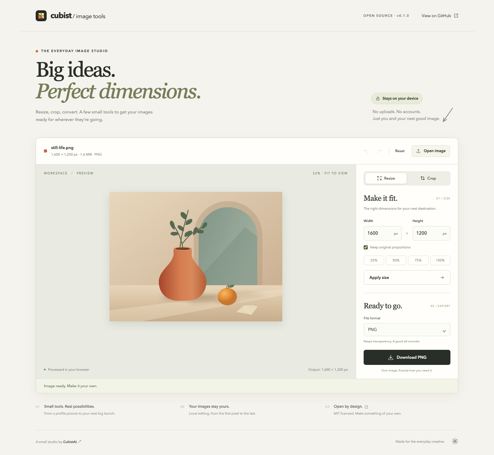

# Cubist Image Tools

**由 [CubistAI · cubistai.app](https://cubistai.app/) 开源并维护。**

在浏览器本地完成图片缩放、裁剪与格式转换。无需注册、API 密钥或上传图片。

[English](README.md) · [操作教程](docs/TUTORIAL.md) · [贡献说明](CONTRIBUTING.md)



## 功能

- 自定义宽高缩放，可锁定比例，支持百分比快捷输入。
- 原始比例、1:1、4:3、3:2、16:9、9:16 和自定义裁剪；支持拖动、触屏及方向键移动裁剪区域。
- 导出 PNG、JPEG，以及浏览器支持时的 WebP；PNG/WebP 保留透明度，JPEG 可选背景色。
- 支持撤销、重做与恢复原图；编辑只保存参数，导出从原始解码图像生成，避免反复缩放的累积损失。
- 文件选择、拖放打开、自带原创示例图，以及移动端布局。

## 本地启动

需要 Node.js 20.19+ 或 22.12+，以及 npm。已用 Node.js 22.18.0、npm 10.9.3 验证。无需同级商业项目或环境变量。

```bash
git clone https://github.com/dgd000/cubist-image-tools.git
cd cubist-image-tools
npm ci
npm run dev
```

打开终端显示的地址，通常为 `http://127.0.0.1:5173`。

```bash
npm run build      # 类型检查并生成 dist/
npm run preview    # 本地预览生产构建
npx playwright install chromium
npm test           # 核心逻辑与 Chromium 浏览器测试
```

`dist/` 可部署到静态托管服务。仓库提供手动触发的 [GitHub Pages 工作流](.github/workflows/pages.yml)，配置步骤见 [发布说明](docs/RELEASING.md)。

## 使用

1. 点击 **Open image**，拖放图片，或点击 **Try the sample image**。
2. 在 **Resize** 输入宽高，点击 **Apply size**。锁定比例时会同步另一边；百分比按当前裁剪区域在原图中的尺寸计算。
3. 在 **Crop** 选择比例、移动裁剪框，点击 **Apply crop**。**Custom** 允许修改裁剪宽高。
4. 选择格式并点击 **Download**。Resize 页的待应用宽高会在下载时应用；裁剪框需要先点 Apply crop。

撤销/重做：输入框之外按 `Ctrl/⌘ Z`、`Ctrl/⌘ Shift Z`。裁剪框聚焦后用方向键移动，Shift 加速至每次十像素。Reset 也可以撤销。

## 隐私与限制

处理在浏览器本地执行，没有图片上传接口、统计脚本、广告、远程字体或图片持久化。刷新后编辑状态消失。托管服务可能保留普通访问日志；自带示例作为同站静态文件加载。外部链接仅在点击时访问。

- 输入仅支持静态 PNG/JPEG/WebP。每张最大 20 MiB、1200 万像素、单边 8192 像素；输出同样受像素与单边限制。
- 不支持动图、GIF、SVG、HEIC、RAW 或批量处理。WebP 导出按浏览器实际编码能力启用。
- JPEG/WebP 采用浏览器编码器与固定质量 0.92，不能保证体积变小。
- 导出生成新图片，不保证保留原始 EXIF、ICC、GPS、DPI 等元数据；不是逐像素无损或专业色彩管理工具。
- 预览最长边 1600 像素，下载使用原图；比例裁剪按整数像素取整。低内存设备仍可能无法处理较大图片。
- 浏览器覆盖情况见 [验证记录](docs/VERIFICATION.md)，不代表所有浏览器与 iOS 版本均已测试。

## 关于 CubistAI

由 [CubistAI](https://cubistai.app/?utm_source=github&utm_medium=referral&utm_campaign=cubist-image-tools) 维护。该仓库只包含独立本地工具，商业主站的 AI、账号、支付等功能不在开源范围内。

部分底层逻辑改编自主站 MIT 许可的图片编辑模块，来源见 [THIRD_PARTY_NOTICES.md](THIRD_PARTY_NOTICES.md)。代码、原创示例和截图使用 [MIT 许可证](LICENSE)。
